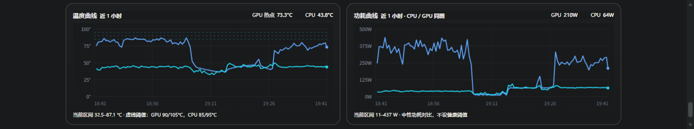

# hwmon-telemetry

Windows 主机硬件遥测：把 LibreHardwareMonitor 和 GPU-Z 的传感器数据聚合成统一 JSON，用一个单文件网页在手机上看实时温度、功耗、电压和历史曲线；再配一个独立推送进程，只在真出故障时推企业微信。

零第三方依赖——`agent.py` 和 `push_monitor.py` 都只用 Python 标准库。

## 两个阈值，两种用途

这是整个项目里最反直觉、也最值得先讲的一点。

同一台机器，网页上的告警线和推送到手机上的告警线**故意不一样**：

| 设备 / 场景 | 实测峰值 | 网页告警线 | 推送告警线 |
|---|---|---|---|
| 台式机跑本地大模型，GPU 满载 530W | GPU 热点 **96.4°C** | 90°C（变黄） | 108°C（不推） |
| 笔记本 i5-12500H 满载（温度墙 100°C） | CPU **100°C** | 95°C（变红） | 不监控 |

如果把网页阈值直接拿去做推送，上面两种情况会导致**天天误报**，消息很快就会被无视——那推送就白做了。

所以两条线各有分工：

- **网页管线盯负载**：你主动打开看的时候，机器正在满载，这时 90°C 是值得知道的信息
- **推送管线盯故障**：手机响的时候，必须是真出事。宁可钝一点，也不能吵

推送线里最有价值的一条是 **16pin 整路电压**（<11.6V 或 >12.8V）。12VHPWR 接口熔毁前通常先出现电压异常，而这个现象与 GPU 负载无关，正常状态下几乎不会误报。

## 界面


独显机型：GPU 核心 / 热点 / 显存结温 / 16pin 电压四张大字卡，下方温度与功耗曲线同图对比。


核显机型：自动隐藏不适用的 GPU 指标，只留 CPU、内存、磁盘。手机竖屏两列排布，一屏读完关键状态。



曲线可从 4 分钟（内存环形缓冲）、1 小时、今日三档切换。图中为实际运行 1 小时的采样，能看到一次负载突降和随后的回升；缺失传感器在曲线上表现为断线，不会被补成 0。

## 能力

**面板**

- 单一 HTML 文件，无构建、无 CDN、无前端框架
- 健康摘要 → 大字卡 → 详情 → 曲线的四层信息密度，手机竖屏也能读
- 温度 / 功耗曲线支持 4 分钟（内存环形缓冲）、1 小时、今日（SQLite 降采样）三档
- 缺失传感器输出 `null`，曲线断线而不是补 0
- 多机切换：按 URL 参数跨机 fetch，返回的设备名与目标不符时拒绝渲染

**推送**

- 独立进程，不依附 agent——agent 崩掉时恰恰最需要告警
- 企业微信群机器人 / PushPlus 双通道，token 留空自动进入 dry-run 只写日志
- 越线需连续 2 次采样确认；恢复需连续 3 次；恢复后 10 分钟内再越线不重复推
- 心跳 30 分钟一条，有告警时自动暂停（避免互相淹没）
- 单实例锁占用 `127.0.0.1:18090`，防重复推送

## 架构

```
台式机 desktop-pc                          笔记本 laptop-pc
├─ LHM  :8085/data.json                    ├─ LHM  :8085/data.json
├─ GPU-Z → gpuz.csv (1Hz)                  ├─ agent.py :8090
├─ agent.py :8090                          ├─ push_monitor.py
└─ hwmon.db                                └─ hwmon.db
        ↑                                          │
        │  ←──── 虚拟局域网（EasyTier 等）─────→    │
        │                                          │
   手机浏览器 ←─────────────────────────────── 企业微信群
```

两台机器各跑一个 `agent.py`。前端跨机 fetch 取数，推送器轮流轮询两台的 `/api/snapshot`。

推送器**只在一台机器上跑**：它主动去拉另一台的接口，被监控方零改动。代价是这台机器彻底宕机时推送会一起静默——这种情况靠「心跳突然消失」自己发现。

## 快速开始

| 组件 | 必需 | 用途 |
|---|---|---|
| Python 3.9+ | 是 | 运行 agent 与推送器，仅标准库 |
| LibreHardwareMonitor | 是 | 传感器数据源，需管理员权限 |
| GPU-Z | 可选 | 独显结温、16pin 电压/功耗，LHM 拿不到的项 |
| 企业微信群机器人 | 可选 | 手机接收推送 |

**1. 启动 LHM 并开启远程 Web Server**

LHM 菜单 `Options → Remote Web Server → Run`，默认监听 `:8085`。

> 这个菜单项必须真实点击。写配置文件无效——LHM 源码里事件是在窗口构造之后才挂上的。硬件枚举未完成时点击还会被静默吞掉。

**2. 启动 agent**

```bash
python agent.py                 # 默认 0.0.0.0:8090
python agent.py --port 8090
python agent.py --dump          # 只打印所有传感器路径，不启服务，用于排查字段名
```

**3. 配置前端**

编辑 `ui.html` 里的 `PEERS`：

```js
const PEERS=[
  {key:'desktop',label:'台式机',device:'your-pc-name',base:'http://192.168.1.10:8090'},
  {key:'laptop',label:'笔记本',device:'your-laptop-name',base:'http://192.168.1.11:8090'}
];
```

`device` 必须与 `socket.gethostname()` 一致，否则前端判定「设备身份不匹配」并拒绝渲染。

**4. GPU-Z（可选）**

`Sensors` 页勾选 `Log to file`，路径设为 `C:\hwsensor\gpuz.csv`（或改 `agent.py` 的 `GPZ_CSV`）。列按表头文本匹配，不依赖固定下标；日志超过 10 秒未更新视为失效，不覆盖 LHM 的读数。

**5. 推送器（可选）**

```bash
cp push_config.example.json push_config.json   # 然后填入 webhook
python push_monitor.py                          # 前台调试
pythonw push_monitor.py                         # 后台无窗口
```

Webhook 取值路径（企业微信 v4.1.41 起入口改名）：内部群聊 → 右上角 `⋯` → **消息推送** → 添加 → 点开刚建的机器人 → Webhook 地址。

> 搜「群机器人」找不到是正常的，它已经改名叫「消息推送」。
> Webhook 地址等同密码，泄露后任何人都能往群里发消息——`push_config.json` 已在 `.gitignore` 中。

自启动（无窗口）：

```powershell
# 注册表 HKCU\Software\Microsoft\Windows\CurrentVersion\Run 添加一项：
#   HWMon-Push  →  pythonw.exe "C:\hwsensor\push_monitor.py"
```

## 接口

| 端点 | 说明 |
|---|---|
| `GET /` | 前端页面 |
| `GET /api/snapshot` | 当前快照 + `health` / `alerts` / `capabilities` / `source_meta` |
| `GET /api/history` | 最近约 4 分钟内存曲线（120 点，2 秒采样） |
| `GET /api/history?window=1h` | 最近 1 小时，SQLite 按时间桶降采样 |
| `GET /api/history?window=today` | 今日 00:00 起 |
| `GET /api/daily?date=YYYY-MM-DD` | 当日统计：min/avg/max、超阈值累计秒数、采样覆盖率 |
| `GET /health` | 精简健康状态，快照过期时 `ok=false` |

网页告警分级（`ALERT_RULES`，属产品预警策略，非硬件官方损坏限值）：

| 指标 | 预警 | 严重 |
|---|---|---|
| GPU 核心 | ≥80°C | ≥90°C（立即生效，不等待确认） |
| GPU 热点 | ≥90°C | ≥105°C |
| GPU 显存结温 | ≥90°C | ≥100°C |
| CPU 封装 / 核心最高 | ≥85°C | ≥95°C |
| 16pin 整路电压 | ≤11.8V | <11.4V 或 >12.6V |
| 内存占用 | ≥75% | ≥90% |
| 磁盘占用 | ≥80% | ≥90% |

普通温度越限需连续 3 个采样才激活，恢复带 2°C 回差，用于抑制毛刺。

## 文件

| 文件 | 说明 |
|---|---|
| `agent.py` | 采集 + HTTP 服务 + SQLite，版本 `hwmon/0.5` |
| `ui.html` | 单文件前端，Canvas 绘制圆环与曲线 |
| `push_monitor.py` | 推送器：轮询、状态机、双通道发送 |
| `push_config.example.json` | 配置模板，复制为 `push_config.json` 后填 webhook |
| `test_agent.py` / `test_push.py` | 后端与推送状态机回归测试 |
| `部署说明.md` | 安装、重启、更新、排查 |
| `推送说明.md` | 推送架构、阈值依据、排障 |
| `交接文档.md` | 接口契约、前端结构、走过的坑 |

```bash
python -m unittest -v test_agent
python -m unittest -v test_push
```

## 已知限制

- **16pin 只能读整路**。per-pin 需要显卡自带分路采样电路（如 ASUS ROG Astral），软件层做不到
- 历史数据各机本地 SQLite，保留 7 天，未做跨设备汇总
- 推送器自身崩溃不会被通知，只能靠心跳消失判断
- 只在一台机器跑推送，那台宕机则全线静默
- 移动端是普通 HTTP 页面，做 PWA 需要 HTTPS
- 核显机型没有独立 GPU 温度传感器，属硬件限制，页面会隐藏空指标

## 踩过的坑

完整 11 条见 `交接文档.md`「环境坑」一节，摘几条最容易反复踩的：

- **SQLite 的 `with connection` 不关闭连接**，Windows 下会导致数据库文件一直被占用 → 必须用显式 `db_session()`
- **LHM 的 Memory Used/Available 含页面文件**，两者相加不等于物理内存 → 改用 `GlobalMemoryStatusEx`
- **Dark Reader 类扩展会改写 computed color**，本地验证颜色必须用无扩展的浏览器，否则纯绿会被压成灰
- **圆环只能用 canvas**。SVG 和 CSS `conic-gradient` 在部分 Chromium 环境渲染不稳定
- **Edge headless 有最小窗口宽度**（约 500px），测窄屏要用 Playwright 的 `setViewportSize`
- **计划任务里启动 WorkBuddy 内置 Python 会 `0xC0000142`** → 自启动改用注册表 Run + `pythonw.exe`
