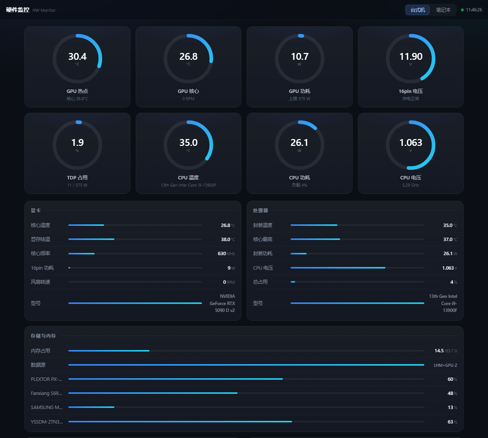
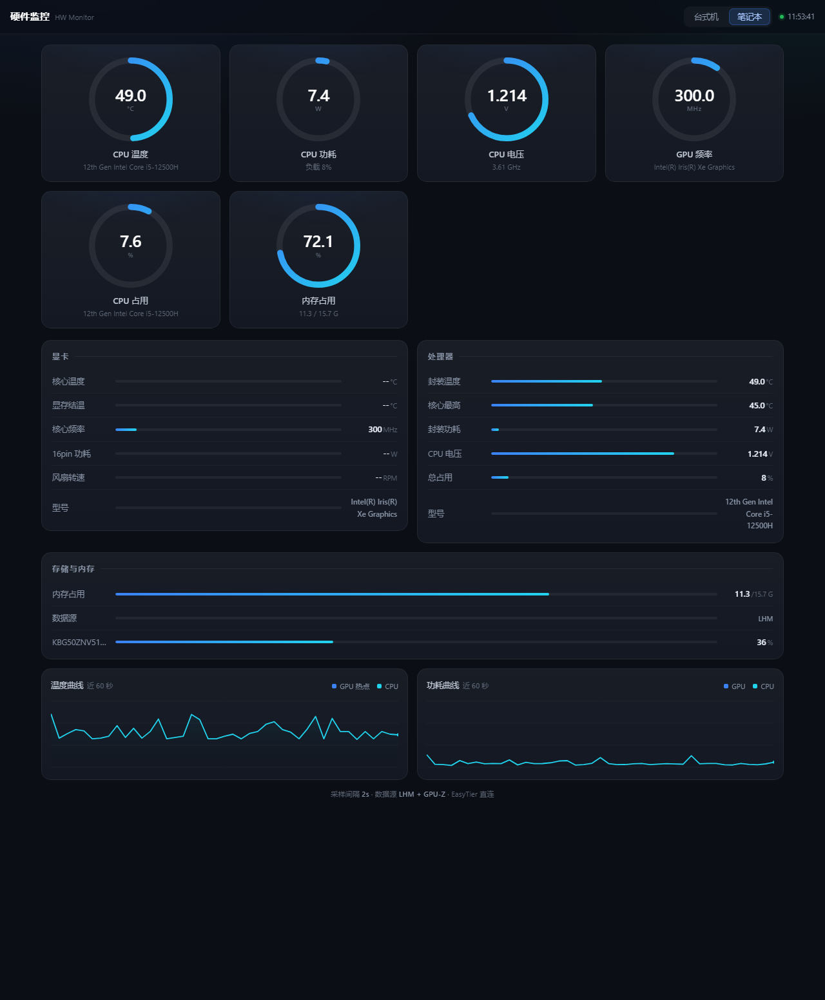

# hwmon-telemetry

Windows 主机硬件遥测面板。把 [LibreHardwareMonitor](https://github.com/LibreHardwareMonitor/LibreHardwareMonitor) 的传感器数据和 GPU-Z 日志聚合成统一 JSON，用一个单文件网页在手机、平板上实时查看温度、功耗、电压和健康告警。

零依赖、零构建：一个 `agent.py`（仅标准库）+ 一个 `ui.html`，跑起来就是一个 `http://<主机>:8090` 的页面。

## 它解决什么

Windows 上想看实时硬件数据，通常要么开 LHM 桌面窗口（不能远程看、不能看历史），要么装一堆采集 + 面板 + 数据库（Prometheus + Grafana + exporter）。这个项目的做法是：不装任何第三方 Python 包，直接读 LHM 的 `/data.json` 和 GPU-Z 的 CSV，用 SQLite 存每日采样，前端用 Canvas 画曲线。

设计上偏重**可信度**而非指标数量：

- 数据源过期不冒充正常——GPU-Z 日志超过 10 秒没更新、快照超过 8/15 秒没刷新，都会降级为预警/严重
- 告警在后端统一计算，前端不另设阈值，避免摘要、卡片、详情三处颜色不一致
- 温度普通越限需连续 3 个采样才激活，恢复带 2°C 回差，抑制毛刺误报
- 缺失传感器输出 `null` 让曲线断线，不补 0

## 界面



左为桌面机（独显 + GPU-Z 16pin 电压），右为核显笔记本（自动隐藏不适用指标）。



> 截图中的硬件型号为作者实机，仅作版式示例。

## 架构

```
台式机 (desktop-pc)                        笔记本 (laptop-pc)
├─ LHM  :8085/data.json                     ├─ LHM  :8085/data.json
├─ GPU-Z → gpuz.csv (1Hz)                   └─ agent.py :8090
├─ agent.py :8090                                ├─ hwmon.db
└─ hwmon.db                                      │
        ↑                                        │
        └──────── 虚拟局域网（EasyTier 等）───────┘
                          ↓
                    手机浏览器
```

两台机器各跑一个 `agent.py`，前端通过 `PEERS` 配置跨机 fetch（依赖 CORS），页面右上角切换设备。不需要公网服务器，组网只做 NAT 穿透。

## 快速开始

**依赖**

| 组件 | 必需 | 用途 |
|---|---|---|
| Python 3.9+ | 是 | 运行 `agent.py`，仅标准库 |
| LibreHardwareMonitor | 是 | 传感器数据源，需管理员权限运行 |
| GPU-Z | 可选 | 提供独显结温、16pin 电压/功耗等 LHM 拿不到的项 |

**1. 启动 LHM 并开启远程 Web Server**

LHM 菜单 `Options → Remote Web Server → Run`，默认监听 `:8085`。注意这个菜单项必须真实点击，写配置文件无效——LHM 源码里事件是在窗口构造之后才挂上的。

**2. 启动 agent**

```bash
python agent.py                 # 默认 0.0.0.0:8090
python agent.py --port 8090
python agent.py --dump          # 只打印所有传感器路径，不启服务，用于排查字段名
```

**3. 配置前端**

编辑 `ui.html` 里的 `PEERS`，改成你的实际地址和主机名：

```js
const PEERS=[
  {key:'desktop',label:'台式机',device:'your-pc-name',base:'http://192.168.1.10:8090'},
  {key:'laptop',label:'笔记本',device:'your-laptop-name',base:'http://192.168.1.11:8090'}
];
```

`device` 必须和 `socket.gethostname()` 的返回值一致，前端会校验返回的设备名，不一致就拒绝渲染（防止串机）。

**4. GPU-Z（可选）**

GPU-Z 的 `Sensors` 标签页勾选 `Log to file`，路径设为 `C:\hwsensor\gpuz.csv`（或改 `agent.py` 里的 `GPZ_CSV`）。列名按表头匹配，不依赖固定下标。

## 接口

| 端点 | 说明 |
|---|---|
| `GET /` | 前端页面 |
| `GET /api/snapshot` | 当前快照 + `health` / `alerts` / `capabilities` / `source_meta` |
| `GET /api/history` | 最近约 4 分钟内存曲线（120 点） |
| `GET /api/history?window=1h` | 最近 1 小时，从 SQLite 按时间桶降采样 |
| `GET /api/history?window=today` | 今日 00:00 起 |
| `GET /api/daily?date=YYYY-MM-DD` | 当日统计：min/avg/max、超阈值累计秒数、采样覆盖率 |
| `GET /health` | 精简健康状态，快照过期时 `ok=false` |

告警分级默认阈值（可在 `ALERT_RULES` 调整，属于产品预警策略，非硬件官方损坏限值）：

| 指标 | 预警 | 严重 |
|---|---|---|
| GPU 核心 | ≥80°C | ≥90°C（立即生效） |
| GPU 热点 | ≥90°C | ≥105°C |
| GPU 显存结温 | ≥90°C | ≥100°C |
| CPU 封装 / 核心最高 | ≥85°C | ≥95°C |
| 16pin 整路电压 | ≤11.8V | <11.4V 或 >12.6V |

## 文件

| 文件 | 说明 |
|---|---|
| `agent.py` | 聚合服务，采样线程 + HTTP 服务 + SQLite |
| `ui.html` | 单文件前端，Canvas 绘制圆环与曲线 |
| `test_agent.py` | 后端回归测试 |
| `部署说明.md` | 安装、重启、更新、排查 |
| `交接文档.md` | 接口契约、前端结构、踩过的坑 |
| `ui-preview.html` | 早期 v3 假数据预览，已与当前 UI 不同步 |

运行测试：

```bash
python -m unittest -v test_agent
```

## 已知限制

- 16pin 只能读到整路电压/功耗，per-pin 需要显卡自带分路采样电路（如 ASUS ROG Astral），软件层做不到
- 历史数据各机本地 SQLite，保留 7 天，未做跨设备汇总
- 移动端是普通 HTTP 页面，做 PWA 需要 HTTPS
- 告警仅页面内呈现，未接系统通知、微信/QQ 推送
- 核显机型没有独立 GPU 温度传感器，属硬件限制，页面会自动隐藏空指标

## 踩坑记录

改代码前建议先读 `交接文档.md` 的「环境坑」一节，那里记了 11 条会反复踩的问题，例如：

- SQLite 的 `with connection` 不关闭连接，Windows 下会锁库 → 必须用 `db_session()`
- LHM 的 Memory Used/Available 含页面文件，相加不等于物理内存 → 改用 `GlobalMemoryStatusEx`
- Dark Reader 类扩展会改写 computed color，本地验证颜色要用无扩展的浏览器
- 圆环只能用 canvas，SVG 和 `conic-gradient` 在部分环境渲染不稳定
